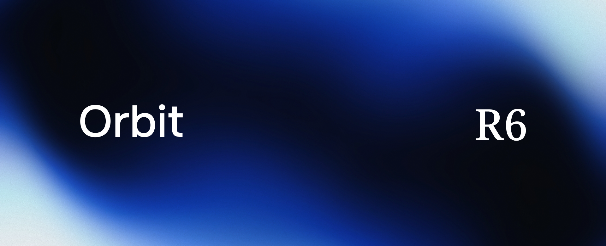

# Orbit R6



R6 is a native x86-64 code generator for the Orbit language IR. It reads
the JSON IR that `orbit build --emit-ir` writes and produces a Windows x64
executable.

[](LICENSE)

## What R6 is not

- R6 does not lower programs through C. GCC never compiles an R6 program.
- R6 does not use GAS. `src/codegen-x64/win64.c` emits a private assembly text,
  `asm_win64.c` encodes it to bytes and `coff.c` writes an AMD64 COFF object.
- GNU `ld` only links. It is the one external tool the program path runs.
- R6 does not guess. An opcode, type, version or platform outside the supported
  set gets one diagnostic and a nonzero exit.
- R6 targets Windows x64 only. Linux and macOS have no measurement.

## Status

Measured on 2026-10-27 at the pin (`ca3eb91`, see below):

| Check | Result | Kind |
|---|---|---|
| Differential (`tests/diff/run_diff.py`) | 61/61 | gate |
| Loader contract suite (`tests/reject/run_reject.py`) | 241/241 (164 rejections, 77 acceptance controls) | gate |
| Corpus (`tests/corpus/run_corpus.py`) | 97 build / 97 match over 132 programs | measurement with a one-way ratchet |
| Compiler-IR census (`tests/compiler-ir/run_census.py`) | 0 build over 27 modules | measurement with a one-way ratchet |

The supported subset is what `docs/M1_REPORT.md` states as measured. Overflow,
NaN payloads, other list kinds and
other operating systems are out of evidence.

## Prerequisites

- Windows x64 and Python 3.
- A GCC for the driver build only. The measured one is w64devkit GCC 16.2.0
  (`C:\w64devkit\bin\gcc.exe`).
- The runtime archive `.r6-build\runtime-win64\libruntime_net.a`. It is not in
  the repository and is not byte-reproducible. Rebuild it from the pinned Orbit
  checkout with `scripts/mklib_runtime.py --out <absolute path>`. `docs/PIN.md`
  lists the recipe and the expected 337-symbol set.
- MinGW CRT and library directories: `R6_MINGW_ROOT` (default `C:/w64devkit`) and
  `R6_MINGW_GCC_VERSION` (default `16.2.0`). Only `ld.exe` is executed.
- For the gates: a fixed-point `orbit` compiler built from the pin, and a
  checkout of `orbit-lang` at the pin.

The absolute paths in this file and in `docs/PIN.md` are observations of one
machine, not requirements.

## Build

```powershell
.\scripts\build-r6.ps1          # -> .r6-build\r6.exe
```

The script uses `$env:R6_CC`, else `$env:CC`, else `gcc` on `PATH`, with
`-std=c11 -Wall -Wextra -Werror`.

## Use

Run from the repository root. The runtime archive path and the temporary files
under `.r6-build` resolve against the current directory.

```powershell
.\.r6-build\r6.exe build program.ir -o program.exe
```

A diagnostic is one line: `r6: <file>:<line>:<col>: error[<CODE>]: <msg>`. Exit
2 is CLI misuse. Exit 1 is every other failure.

## Gates

The commands below were verified on 2026-10-26 on the machine named in
`docs/PIN.md`. `--r6-command` must be the last argument.

```powershell
python tests/diff/run_diff.py `
  --compiler C:\Temp\orbit-fp-33ea94e9ec.exe `
  --cc C:\w64devkit\bin\gcc.exe `
  --orbit-root C:\Temp\orbit-pin-ca3eb91-git `
  --r6-command .r6-build\r6.exe build '{ir}' -o '{exe}'

python tests/reject/run_reject.py
python tests/reject/make_cases.py --check
```

The verdict of the differential is identical exit code and identical stdout
bytes against the GCC build of the Orbit oracle. Contribution rules are in
`CONTRIBUTING.md`.

`scripts/ci.ps1` runs the build, `make_cases.py --check` and the loader suite
and stops at the first failure. `-Diff` and `-Corpus` add the differential and the
corpus ratchet, and take `-Compiler`, `-OrbitRoot` and `-Cc`.
`.github/workflows/ci.yml` runs it on every push and pull request; its `oracle`
job builds the fixed point and runs on manual dispatch.

Corpus and census:

```powershell
python tests/corpus/run_corpus.py `
  --compiler C:\Temp\orbit-fp-33ea94e9ec.exe `
  --cc C:\w64devkit\bin\gcc.exe `
  --orbit-root C:\Temp\orbit-pin-ca3eb91-git `
  --check `
  --r6-command .r6-build\r6.exe build '{ir}' -o '{exe}'

python tests/compiler-ir/run_census.py `
  --compiler C:\Temp\orbit-fp-33ea94e9ec.exe `
  --tree C:\Temp\orbit-pin-ca3eb91-git `
  --r6-command .r6-build\r6.exe build '{ir}' -o '{exe}'
```

## The pin

R6 is pinned to one `orbit-lang` commit: `ca3eb9103dfcff03f11831eddb8be98bc521b787`,
on the public remote `https://github.com/joacokhzyx/orbit-lang`.
The pin is the Orbit commit and the inputs listed in `docs/PIN.md`: the IR
emitter, the fixed-point compiler, the runtime recipe, the runtime symbol set
and the corpus hash.

- Pinned bytes come from `git cat-file blob ca3eb91:<path>`, never from a
  working tree that may be ahead of the pin.
- The corpus and the census regenerate from a tree materialized at the pin.
  `--orbit-root` and `--tree` must point at that tree.
- `tests/corpus/manifest.json` carries the SHA-256 of every corpus document.
  `tests/corpus/baseline.json` and `tests/compiler-ir/baseline.json` are the
  ratchets: `r6BuildOk` and `match` may not go down.
- Moving the pin takes a dated entry in `docs/DECISIONS.md`, and moves
  `docs/PIN.md`, the corpus manifest and the baseline in one commit.

## Layout

| Path | Content |
|---|---|
| `src/loader/` | Strict JSON IRv1 parser and validator; admits opcodes |
| `src/codegen-x64/` | `win64.c` (IR to private asm text), `asm_win64.c` (encoder), `coff.c` (COFF writer) |
| `src/driver/r6.c` | CLI, temporaries under `.r6-build`, direct `ld` link |
| `tests/diff/` | Differential harness |
| `tests/reject/` | Loader contract suite: `manifest.json` is the truth, `cases/` is rendered from it |
| `tests/corpus/` | Language-emitted corpus manifest, ratchet and runner |
| `tests/compiler-ir/` | Census of the compiler's own IR |
| `docs/` | `PIN.md`, `CONTRACT.md`, `DECISIONS.md`, `M1_PLAN.md`, `M1_REPORT.md`, fixtures in `proposed-ir/m1/` |
| `scripts/` | `build-r6.ps1`, `migrate-m1-fixtures.py` |

Contract prose in `docs/` is Spanish. `AGENTS.md` holds the working rules.

## License

MIT. See `LICENSE`.
